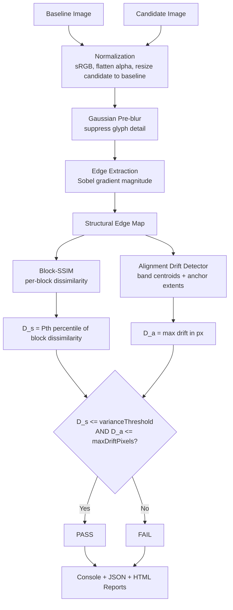

# Specification: UI-Diff Image Directory Comparison Engine

## 1. Overview & Problem Statement

### 1.1 Context
After a framework or UI library upgrade (e.g. React/CSS framework version bump), the application must still look **structurally** the way it was designed. Screenshots of dynamic applications (e.g. room booking, event management, calendar dashboards) contain live content (room titles, attendee counts, timestamps, booking statuses, number of rows) that legitimately differs between runs.

Standard pixel-by-pixel comparisons (`pixelmatch`, raw RGB diffs) produce excessive false positives because content differs. What must remain stable is **how the UI is presented**: bounding boxes, containers, grids, and element alignment.

### 1.2 Objective
Provide a layout diffing tool (`ui-diff`) that compares a **baseline directory** (the approved/designed state) against a **current directory** (post-upgrade) and detects major UI breakages (right-aligned buttons becoming left-aligned, broken grids, collapsed containers, overlapping components, missing components) while tolerating content variance within a configurable threshold.

### 1.3 Non-Goals
- Comparing text content, data values, or the number of list rows. These are application concerns, not presentation concerns.
- Comparing colours, fonts, or image content (the comparison is edge/structure based).
- Baseline approval/update workflow.
- Per-region ignore masks (may be added later).

### 1.4 Implementation Context
- Language: TypeScript (Node.js), matching the existing workspace.
- Location: new workspace package `packages/ui-diff/`.
- Image I/O and convolution: [`sharp`](https://sharp.pixelplumbing.com/).
- CLI parsing: `commander`.
- Dependencies MUST be the latest stable, actively maintained versions and be recorded in the lock file.

---

## 2. System Architecture & Comparison Pipeline



### 2.1 Processing Stages

1. **Image Pairing**
   - Recursively traverse both directories (symlinks are followed).
   - Pair images by relative path. Matching is **case-sensitive** and ignores the file extension (`a.png` pairs with `a.jpg`; a warning is emitted when extensions differ).
   - Image in baseline only → `FAIL` with reason `MISSING_IN_CURRENT` (unless `--no-fail-on-missing`, then a warning).
   - Image in current only → status `NEW` (warning, never fails the run).
   - Processing order is deterministic (sorted by relative path).

2. **Normalization**
   - Decode to sRGB. Apply EXIF auto-orientation. Animated formats use the first frame only.
   - Composite transparency onto a white background.
   - **Dimensions**: the candidate is always resized (bilinear) to the baseline dimensions before comparison. Size alone NEVER causes a failure. If either dimension differs by more than **10%**, a `DIMENSION_WARNING` is recorded for the image and shown in all reports.
   - Screenshots are expected to be captured at the same device pixel ratio; images are compared in the baseline's pixel space.

3. **Structural Feature Extraction**
   - Convert to grayscale luminance.
   - Apply a Gaussian blur (`blurRadius`, default 2 px) to suppress character-level detail so that different text strings produce near-identical footprints. Blur is **always applied**; there is no toggle.
   - Apply a Sobel operator and threshold the gradient magnitude at `edgeThreshold` to produce the **structural edge map**. Card borders, input outlines, button outlines, and dividers survive; text becomes low-energy texture.
   - The gradient magnitude is normalised by `4 × 255` (the response of a full-contrast axis-aligned step), so `edgeThreshold` is a fraction of real edge contrast (`1.0` = black/white step). Border pixels are never edges.
   - **Tuning note:** `edgeThreshold` trades "ignore text" against "see low-contrast structure". Too low and text edges re-enter the map (text changes then fail); too high and faint borders vanish. The default `0.2` was the only value in the synthetic fixtures where all scenarios behaved correctly. It must be validated on real approved screenshots (AC16).

4. **Structural Dissimilarity (`D_s`)**
   - **Shift tolerance:** before comparison the edge maps are matched within `maxDriftPixels`. Every edge pixel with a counterpart in the other map within that Euclidean distance is snapped to the counterpart's exact position, so edges displaced by no more than `maxDriftPixels` contribute **zero** dissimilarity. Only edges that are added, removed, or displaced by more than `maxDriftPixels` remain different. (Plain SSIM on binary edge maps is all-or-nothing: a 1–7 px shift would score ~1.0 dissimilarity.) Distance is computed with an exact Euclidean distance transform, so cost is independent of the radius.
   - Divide both (matched) edge maps into non-overlapping blocks of `gridSize` × `gridSize` px.
   - Compute SSIM for each block pair and convert: `dissimilarity = clamp(1 - SSIM, 0, 1)`.
   - `D_s` is the **P-th percentile** (default `P = 95`) of the per-block dissimilarity values. With P95, up to 5% of blocks may be noisy outliers without affecting the result.
   - Blocks that are empty (no edges) in both images are excluded from the percentile population so large blank areas do not dilute the result.

5. **Alignment Drift (`D_a`)**
   Drift is measured on the **tolerance-matched** edge maps (same as D_s), on both axes, and must detect both small nudges and large displacements (e.g. right-anchored → left-anchored). Using the matched maps means that a shift within `maxDriftPixels` does not register as drift (band centroids and extents move when edges cross a band boundary, so measuring on raw maps would give spurious drift).
   - Split the edge map into horizontal bands and vertical bands of `gridSize` px thickness.
   - For every band with edge mass in either image compute:
     - the **edge-mass centroid** (along the band's axis), and
     - the **anchor extents**: the first and last edge position along the band's axis (e.g. the right-most edge of a right-aligned toolbar).
   - Band drift = `max(|Δcentroid|, |Δfirst extent|, |Δlast extent|)`, in baseline pixels.
   - A band that has edge mass in only one image is treated as maximum drift for that band (component appeared/disappeared). Such a one-sided band is attributed to the **perpendicular axis** and uses that axis' full length as its drift. It only counts when at least a minimum fraction of its edge pixels have **no counterpart within `maxDriftPixels`** in the other map; otherwise edges merely crossing a band boundary would be misreported as appearing/disappearing.
   - `D_a` = the maximum band drift over all bands and both axes.
   - Extents are used in addition to centroids so that right-aligned content with varying text length is judged by its anchored edge rather than its centre of mass.

6. **Decision Rule**
   - An image pair **PASSES** if:
     $$D_s \le \text{varianceThreshold} \quad \text{AND} \quad D_a \le \text{maxDriftPixels}$$
   - Otherwise it **FAILS**. All violated conditions are reported (a `reasons` array), not only the first.

---

## 3. CLI & Configuration Interface

### 3.1 CLI Usage

```bash
# Basic run
ui-diff --baseline ./screenshots/baseline --current ./screenshots/current

# Custom thresholds and output directory
ui-diff -b ./baseline -c ./current --variance 0.05 --max-drift 8 --output ./diff-report

# JSON only (no console table, no HTML)
ui-diff -b ./baseline -c ./current --format json
```

### 3.2 CLI Options

| Flag | Shorthand | Type | Default | Description |
|---|---|---|---|---|
| `--baseline` | `-b` | `string` | *(required)* | Baseline (approved) images directory |
| `--current` | `-c` | `string` | *(required)* | Current (post-change) images directory |
| `--output` | `-o` | `string` | `./ui-diff-report` | Output directory for reports. Overwritten in place on each run |
| `--variance` | | `number` | `0.05` | Maximum acceptable `D_s` (0.0–1.0) |
| `--max-drift` | `-d` | `number` | `8` | Maximum acceptable `D_a` in pixels |
| `--percentile` | | `number` | `95` | Percentile (1–100) of block dissimilarity used for `D_s` |
| `--grid-size` | | `number` | `16` | Block/band size in px |
| `--blur-radius` | | `number` | `2` | Gaussian blur radius in px applied before edge extraction |
| `--edge-threshold` | | `number` | `0.2` | Normalised gradient magnitude threshold (0.0–1.0) |
| `--config` | | `string` | `ui-diff.config.json` | Optional JSON configuration file |
| `--format` | `-f` | `string` | `console,html` | Comma-separated reporters: `console`, `html`, `json`. Reporters are independent; only those listed run |
| `--no-fail-on-missing` | | `boolean` | *(off)* | Downgrade `MISSING_IN_CURRENT` from failure to warning |
| `--allow-empty` | | `boolean` | *(off)* | Do not fail when no images are found to compare |
| `--concurrency` | | `number` | `2` | Number of image pairs compared in parallel |

Notes:
- There is no `--exit-on-fail` flag. The process **always** exits non-zero when the run fails.
- There is no `ignoreTextContent` option. Structural-only comparison is always applied.
- `-v` is intentionally not used as a shorthand (conventionally `--version`).
- `--version` and `--help` are supported.

### 3.3 Configuration File (`ui-diff.config.json`)

Precedence: **CLI flags > config file > built-in defaults**. Relative paths in the config file resolve against the config file's directory. Unknown keys are rejected with a usage error.

```json
{
  "baseline": "./screenshots/baseline",
  "current": "./screenshots/current",
  "output": "./ui-diff-report",
  "comparison": {
    "varianceThreshold": 0.05,
    "maxDriftPixels": 8,
    "percentile": 95,
    "gridSize": 16,
    "blurRadius": 2,
    "edgeThreshold": 0.2
  },
  "reporters": ["console", "html", "json"],
  "failOnMissing": true,
  "allowEmpty": false,
  "concurrency": 2
}
```

| Config key | CLI flag |
|---|---|
| `baseline` / `current` / `output` | `--baseline` / `--current` / `--output` |
| `comparison.varianceThreshold` | `--variance` |
| `comparison.maxDriftPixels` | `--max-drift` |
| `comparison.percentile` | `--percentile` |
| `comparison.gridSize` | `--grid-size` |
| `comparison.blurRadius` | `--blur-radius` |
| `comparison.edgeThreshold` | `--edge-threshold` |
| `reporters` | `--format` |
| `failOnMissing` | `--no-fail-on-missing` (inverse) |
| `allowEmpty` | `--allow-empty` |
| `concurrency` | `--concurrency` |

---

## 4. Statuses, Reasons & Exit Codes

### 4.1 Per-image status

| Status | Meaning | Fails run? |
|---|---|---|
| `PASS` | `D_s` and `D_a` within thresholds | No |
| `FAIL` | One or more `reasons` apply | Yes |
| `NEW` | Image exists only in current | No (warning) |
| `MISSING` | Image exists only in baseline and `--no-fail-on-missing` is set | No (warning) |

### 4.2 Failure reasons (`reasons` array on `FAIL`)

| Reason | Condition |
|---|---|
| `STRUCTURAL_VARIANCE` | `D_s > varianceThreshold` |
| `ALIGNMENT_DRIFT` | `D_a > maxDriftPixels`; includes axis (`horizontal`/`vertical`) and offending band |
| `MISSING_IN_CURRENT` | Present in baseline only (and `failOnMissing` is on) |
| `INVALID_IMAGE` | Unreadable/corrupt image; includes error detail. Always a failure |

### 4.3 Warnings
Per-image codes: `DIMENSION_WARNING` (size differs by > 10%), `EXTENSION_MISMATCH`, `MISSING_IN_CURRENT` (when `--no-fail-on-missing`), `NEW_IN_CURRENT` (image only in current). Run-level: `EMPTY_INPUT` (when `--allow-empty`). Warnings never affect the exit code.

### 4.4 Exit codes

| Code | Meaning |
|---|---|
| `0` | Run succeeded: no `FAIL` results |
| `1` | At least one image `FAIL`, or no images found (without `--allow-empty`) |
| `2` | Usage/configuration error (missing required args, unknown flag, invalid value, nonexistent directory, invalid config file) |

Usage errors print usage guidance and a clear message (including the offending path where relevant) and never throw an unhandled exception.

---

## 5. Output Artifacts

1. **Console** (`console`): table with Image Name, Status, `D_s` %, `D_a` px, and reasons; followed by a summary line and any warnings.
2. **JSON** (`json`): `diff-results.json`:
   ```json
   {
     "version": 1,
     "timestamp": "2025-01-01T12:00:00.000Z",
     "config": { "varianceThreshold": 0.05, "maxDriftPixels": 8, "percentile": 95 },
     "summary": { "total": 12, "passed": 9, "failed": 2, "new": 1, "errored": 0 },
     "images": [
       {
         "name": "desktop/calendar.png",
         "status": "FAIL",
         "reasons": ["ALIGNMENT_DRIFT"],
         "variance": 0.031,
         "drift": 412,
         "driftAxis": "horizontal",
         "warnings": [],
         "assets": { "baseline": "assets/baseline/desktop/calendar.png", "current": "assets/current/desktop/calendar.png", "edgeMap": "assets/edge/desktop/calendar.png", "diff": "assets/diff/desktop/calendar.png" }
       }
     ]
   }
   ```
   `errored` counts `INVALID_IMAGE` results (which are also counted in `failed`).
3. **HTML** (`html`): `index.html` in the output directory.
   - For each image: Baseline, Current, Structural Edge Map, and Diff Overlay, with a baseline/current **slider** in addition to side-by-side view.
   - The overlay highlights failing blocks (`D_s` contributors) and draws red bounding boxes around bands that exceed `maxDriftPixels`.
   - Failed images are listed first; passing images are included and collapsed.
   - Supporting images are written under `assets/` mirroring the relative input paths (nested directories are preserved). The report must contain no broken image links.

---

## 6. Acceptance Criteria

### AC1: CLI invocation with required arguments
- **Input:** `ui-diff -b ./dir-a -c ./dir-b`, both directories exist with valid images.
- **Expected:** Summary table printed; exit `0` if all pass.
- **Failure:** Missing required arguments (e.g. only `-b`) must print usage guidance and exit `2`, never throw an unhandled exception.

### AC2: Same layout, different content (benign variance)
- **Input:** Same headers, cards, inputs and right-aligned action buttons, but different text (e.g. "Room 101 - Booked" vs "Room 305 - Available") and different row counts within a list container.
- **Expected:** `PASS` with `D_s ≤ 0.05` and `D_a ≤ 8`.
- **Failure:** `FAIL` due to text/content differences.

### AC3: Alignment breakage (right-aligned → left-aligned)
- **Input:** Baseline has a primary action button/toolbar on the right margin; candidate has it on the left or centred.
- **Expected:** `FAIL`, reasons contain `ALIGNMENT_DRIFT` with `horizontal` axis and drift > `maxDriftPixels`. Vertical displacement is detected equally (`vertical` axis).
- **Failure:** Passes or ignores the shift.

### AC4: Structural component addition / removal
- **Input:** Candidate is missing a major navigation bar, sidebar card, or table column.
- **Expected:** `FAIL` via `ALIGNMENT_DRIFT` (a band with edge mass in only one image counts as maximum drift) and/or `STRUCTURAL_VARIANCE`.
- **Failure:** Treated as negligible variance.

### AC5: Custom tolerance via CLI
- **Input:** `--variance 0.10 --max-drift 15`.
- **Expected:** Thresholds `0.10` and `15 px` are applied and recorded in the JSON `config`.
- **Failure:** Arguments ignored or defaults used. CLI values must override config file values.

### AC6: Missing file detection
- **Input:** Baseline contains `booking-modal.png`; current does not.
- **Expected:** `FAIL` with reason `MISSING_IN_CURRENT`, exit `1`. With `--no-fail-on-missing`, reported as a warning and exit `0` (assuming nothing else fails).
- **Failure:** Silently ignored.

### AC7: HTML report generation
- **Input:** `--format html --output ./reports`.
- **Expected:** `./reports/index.html` with baseline, current, edge map, and diff overlay for all pairs; no console table is printed; all image links resolve.
- **Failure:** Missing file or broken links.

### AC8: JSON report generation
- **Input:** `--format json --output ./reports`.
- **Expected:** `./reports/diff-results.json` valid per the schema in §5 (`version`, `timestamp`, `summary`, `images[]` with `name`, `status`, `reasons`, `variance`, `drift`).
- **Failure:** Malformed JSON or missing fields.

### AC9: Non-zero exit code on failure
- **Input:** At least one image pair fails.
- **Expected:** Exit code `1`, with no flag required.
- **Failure:** Exit `0` despite failures.

### AC10: Recursive directory traversal
- **Input:** Nested subdirectories (e.g. `desktop/calendar.png`, `mobile/calendar.png`).
- **Expected:** Sub-paths paired correctly; report assets mirror the structure.
- **Failure:** Nested folders skipped or flattened (so `desktop/calendar.png` and `mobile/calendar.png` collide).

### AC11: Dimension difference does not fail
- **Input:** Candidate is 8% taller than baseline with the same structure; and a second pair 15% taller.
- **Expected:** Both are compared after resize; neither fails on size alone; the 15% pair carries `DIMENSION_WARNING`.

### AC12: New image in current
- **Input:** Current contains `new-screen.png` absent from baseline.
- **Expected:** Status `NEW`, warning shown, run not failed.

### AC13: Invalid image
- **Input:** A corrupt `.png` in current.
- **Expected:** `FAIL` with `INVALID_IMAGE` and error detail; remaining pairs still processed; exit `1`.

### AC14: Empty input
- **Input:** Both directories exist but contain no supported images.
- **Expected:** Warning `EMPTY_INPUT`; exit `1`, or exit `0` with `--allow-empty`.

### AC15: Config file precedence
- **Input:** Config sets `maxDriftPixels: 20`; CLI passes `--max-drift 4`.
- **Expected:** `4` is used. Without the CLI flag, `20` is used. Invalid or unknown config keys exit `2`.

### AC16: Calibration fixtures
Synthetic image pairs live in `packages/ui-diff/test/fixtures/` and drive automated tests:

| Fixture | Expected |
|---|---|
| `identical/` | `PASS`, `D_s ≈ 0`, `D_a = 0` |
| `text-change/` (AC2) | `PASS` |
| `alignment-shift/` (AC3) | `FAIL`, `ALIGNMENT_DRIFT` |
| `component-removed/` (AC4) | `FAIL` |
| `size-mismatch/` (AC11) | `PASS` with warning |
| `missing/`, `new/`, `corrupt/` | AC6, AC12, AC13 |

The default thresholds (`0.05`, `8 px`, P95, `edgeThreshold` 0.2, `blurRadius` 2) were trialled on the uivisor test-app (six pages, 1280 × 800, Playwright/Chromium), using variants of the baseline made by injecting CSS/text changes. Results: a spacing/padding regression failed on login and profile; a 6 × 4 px nudge and a colour-only change passed; a text rewrite **failed** on login (heading glyph edges). The injected regression only touched classes used on login and profile, so it says nothing about the other pages. Coverage on sparse pages is weak: at 0.2, `integration-sessions` kept ~115 edge pixels and the task list ~1.6k. In a sweep of the implemented knobs (threshold 0.02–0.2, blur 2–8), no setting passed the login text rewrite. A prototype long-straight-run filter (not implemented) at threshold 0.2 passed the text rewrite and failed the regression, but then failed colour-only changes. This is a small, single-application trial, not a validation: calibrate on your own approved screenshots (AC16 stays open for the target application).

---

## 7. Edge Cases & Error Handling

| Scenario | Behaviour |
|---|---|
| **Directory does not exist** | Error naming the path; exit `2`. |
| **Non-image files** | Ignored. Supported: `.png`, `.jpg`, `.jpeg`, `.webp`. |
| **Dimension mismatch (> 10%)** | Resize candidate, record `DIMENSION_WARNING`; not a failure. |
| **Corrupted / unreadable image** | `FAIL` with `INVALID_IMAGE` and detail; run continues. |
| **Empty directories** | `EMPTY_INPUT` warning; exit `1` unless `--allow-empty`. |
| **Extension differs for same stem** | Paired, with `EXTENSION_MISMATCH` warning. |
| **Duplicate stems in one directory** (`a.png` and `a.jpg`) | Usage error, exit `2` (ambiguous pairing). |
| **Output directory exists** | Overwritten in place. |
| **Invalid option values** (e.g. `--variance 2`, `--percentile 0`) | Error naming the option; exit `2`. |
| **Full-blank image pair** | `D_s = 0`, `D_a = 0`, `PASS`. |

Error messages shown to users are concise and never include stack traces; detailed errors are written to the JSON/HTML report only for `INVALID_IMAGE` and to a debug log when `DEBUG` is set.

---

## 8. Known Trade-offs

- **P95 vs small components:** a removed component covering under 5% of blocks may not move `D_s` past the threshold. It is expected to be caught by the drift check (§2.1.5, band with edge mass in one image only). If calibration (AC16) shows gaps, raise the percentile toward 99 or add a contiguous-failing-region rule.
- **Resize distortion:** resizing a candidate whose width differs from the baseline distorts horizontal geometry and can produce drift. The 10% warning flags such cases for manual review.
- **Fixed viewport assumption:** the tool assumes baseline and current screenshots are captured with the same viewport and device pixel ratio.
- **Text changes can fail on pages with a bold heading (known limitation).** At `edgeThreshold` 0.2 only high-contrast elements enter the edge map: bold headings, thick button outlines. Faint input borders and card outlines drop out. A rewritten heading changes the glyph edges that dominate the map, so `D_s` ≈ 1.0 on the login page. This conflicts with the goal of ignoring text. Lower thresholds and larger blur did not fix it in the trial (threshold 0.02–0.2, blur 2–8). Candidate fixes, not yet implemented: mask or down-weight text-like regions, or compare only long straight edge runs (a prototype at threshold 0.2 fixed the text case but made colour-only changes fail).
- **Drift uses matched maps.** Both `D_s` and `D_a` are measured on the tolerance-matched edge maps. A real shift that falls exactly at the tolerance boundary therefore scores zero on both metrics. If this boundary region matters for a particular application, lower `maxDriftPixels` by a few pixels from the true acceptable limit.
